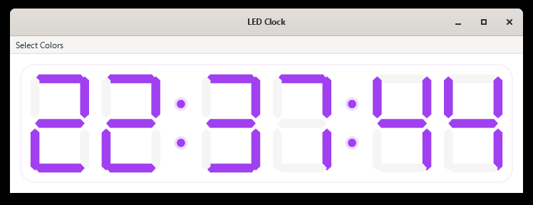

# 7Seg

A desktop clock for Windows that shows the time as a six-digit, seven-segment
LED display. It is written in C with GTK 4 and Cairo.



## What it does

- Shows local time as `HH:MM:SS`, in 24-hour format.
- Lit segments are drawn in the chosen colour. Unlit segments stay faintly
  visible in light grey, as on a real LED display.
- The colons are lit for the first half of every second and unlit for the
  second half.
- **Select Colors** offers eight colours: Lime, Amber, Red, Teal, Navy,
  Pink, Purple (the default) and Gold.
- The display scales with the window.
- The window is redrawn only when the display changes, just after each
  second and each half-second.

Opening the clock again while it is running opens a second window in the
same program. Each window keeps its own colour.

## Building and running

You need [MSYS2](https://www.msys2.org/). In its **MINGW64** terminal,
install the compiler and GTK 4:

```bash
pacman -S mingw-w64-x86_64-gcc mingw-w64-x86_64-pkgconf mingw-w64-x86_64-gtk4
```

Then build:

```bash
git clone https://github.com/nishantmajhi/7Seg.git
cd 7Seg
./build.sh
```

`build.sh` compiles the clock into `dist/clock.exe` and copies in the GTK
DLLs and data it needs. It runs with nothing from MSYS2 on `PATH`, so you
can copy `dist/` elsewhere and double-click `clock.exe`.

To build somewhere other than `dist/`, give `build.sh` a folder:
`./build.sh ../7seg-bundle`. The folder is deleted and rebuilt, so
`build.sh` refuses any folder that is neither empty nor a previous build.

To compile without bundling, which gives a `clock.exe` that only runs
inside MSYS2:

```bash
gcc -mwindows src/clock.c src/face.c -o clock.exe $(pkg-config --cflags --libs gtk4) -lm
```

## Tests

From the MINGW64 terminal:

```bash
tests/run.sh
```

There are four suites:

- `face_test` checks what the display shows, in plain C: which segments
  each digit lights, the palette, which digits a time reads as, when the
  colons are lit, and how long to wait before the next change.
- `render_test` draws the face off screen at fixed times, colours and
  sizes, and compares every pixel with the images in `tests/golden/`.
  Those images were drawn by the first commit's code
  (`tests/make_golden.sh`), so this suite checks the clock still looks
  exactly as it did.
- `app_test` opens real windows. It covers two windows at once, choosing
  colours from the menu, closing windows, and how often an idle window
  is redrawn.
- `dist_test` builds a bundle and starts it with nothing from MSYS2 on
  `PATH`. It starts it once as a double-click would and once as an MSYS2
  shell would.

Windows appear on screen for a few seconds while the last two run.
`tests/run.sh --original` runs the same suites against the first commit,
which must fail every check named `regression:` and nothing else.

## Layout

```
7Seg/
├── src/
│   ├── clock.c     GTK window, menu, drawing and timing
│   ├── face.c      what the display shows, with no GTK in it
│   └── face.h
├── tests/          see above
├── build.sh        compile and bundle into dist/
├── icon.png        window icon, 256×256
└── screenshot.png
```

## Licence

Free for personal, non-commercial use. You may use, study and modify this
software for yourself, but you may not use it commercially, and you may not
share or publish it, in its original form or modified. See [LICENSE](LICENSE)
for the full terms.

## Author

**Manish Majhi** — [@nishantmajhi](https://github.com/nishantmajhi)
